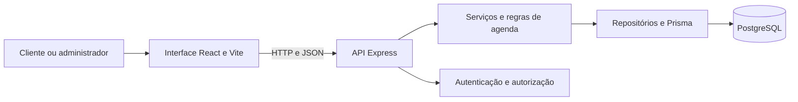
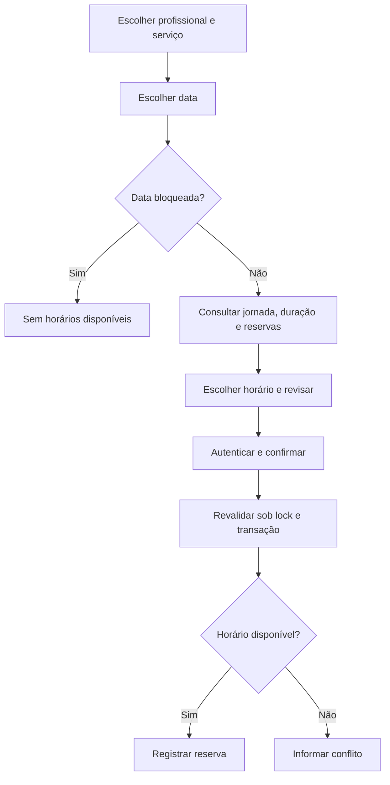
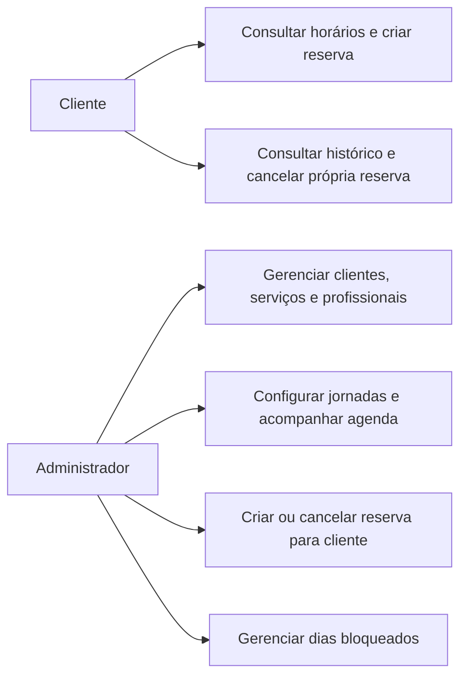
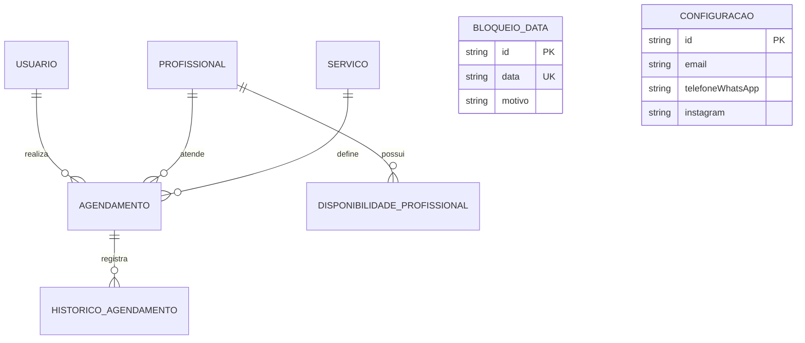
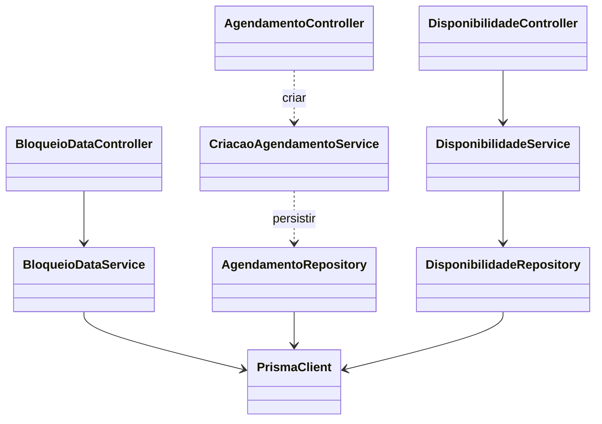

# DESENVOLVIMENTO DE UM SISTEMA WEB PARA ORGANIZAÇÃO DE AGENDAMENTOS EM BARBEARIAS

## DEVELOPMENT OF A WEB SYSTEM FOR APPOINTMENT ORGANIZATION IN BARBERSHOPS

Bruno Monteiro Alves

### Resumo

Pequenas barbearias precisam organizar a agenda enquanto atendem clientes, frequentemente recorrendo a mensagens e anotações que dificultam identificar períodos livres. Este artigo apresenta o desenvolvimento incremental de um sistema web para uma barbearia, com foco em profissionais, serviços, jornadas e reservas. O objetivo foi oferecer horários compatíveis com a duração do serviço e disponibilizar à administração meios para configurar e acompanhar a agenda. O planejamento inicial foi delimitado ao núcleo de agendamento. A aplicação representa a jornada em blocos de trinta minutos e considera períodos ocupados, duração dos serviços e datas bloqueadas ao consultar e confirmar reservas. A versão apresentada inclui cadastro, autenticação, controle de acesso, agendamento em etapas, cancelamento, histórico e painel administrativo. Para alterar data ou horário, o usuário deve cancelar a reserva e criar outra. O administrador pode bloquear datas sem reservas pendentes, confirmadas ou atrasadas. O sistema alerta sobre outra reserva ativa do mesmo cliente no mesmo dia, sem impedir uma nova solicitação. A compilação e a análise estática foram executadas, e as migrações foram aplicadas em banco local de demonstração. Essas verificações não comprovam todos os fluxos nem substituem avaliação com usuários, auditoria de acessibilidade e validação em produção. Como possibilidades futuras, são discutidas notificações por WhatsApp e um agente conversacional integrado ao backend.

**Palavras-chave:** agendamento. barbearias. sistemas de informação. gestão de horários. desenvolvimento web.

### Abstract

Small barbershops often manage their schedules while serving customers, using messages and notes that make it difficult to identify available periods. This paper presents the incremental development of a web system for a barbershop, focusing on professionals, services, work schedules and appointments. Its aim was to provide time slots compatible with service duration and tools for administrators to configure and monitor the schedule. The original scope was narrowed to the scheduling core. The application represents schedules in thirty-minute blocks and considers occupied periods, service duration and blocked dates when checking and confirming appointments. The current version includes registration, authentication, access control, staged booking, cancellation, history and an administrative panel. To change an appointment's date or time, users must cancel it and create another. Administrators can block dates without pending, confirmed or late appointments. The system warns about another active appointment for the same customer on the same date without automatically preventing a new request. The build and static analysis were executed, and migrations were applied to a local demonstration database. These checks do not establish that every workflow has been validated, nor replace user evaluation, accessibility assessment or production validation. WhatsApp notifications and a conversational agent integrated with the backend are discussed as future work.

**Keywords:** scheduling. barbershops. information systems. time management. web development.

## 1. INTRODUÇÃO

Uma pequena barbearia precisa conciliar o atendimento com a organização da agenda. Ao receber uma solicitação, o profissional pode precisar interromper o serviço para consultar mensagens e anotações. Mesmo ao identificar um intervalo, é necessário verificar se ele comporta a duração do atendimento solicitado. A informação distribuída entre diferentes meios dificulta recuperar compromissos e reconhecer períodos livres.

O problema não se limita ao horário inicial. Serviços podem ter durações diferentes e profissionais podem cumprir jornadas distintas. Reservas já assumidas, cancelamentos e dias sem atendimento também modificam a disponibilidade. A organização dessas informações em uma aplicação pode apoiar a consulta e a confirmação de horários compatíveis.

O trabalho teve origem no Projeto Integrador de 2025, cujo planejamento incluía pagamentos, produtos, assinaturas, fidelidade, relatórios e notificações. No TCC, o escopo foi delimitado a uma barbearia e ao núcleo de profissionais, serviços, jornadas e agendamentos. Não foram medidas redução de tempo de atendimento ou ganhos financeiros.

A questão de pesquisa é: como desenvolver um sistema web simples e responsivo capaz de organizar os agendamentos de uma barbearia, considerando a jornada dos profissionais, a duração dos serviços e a prevenção de conflitos? O objetivo geral é desenvolver essa solução. Os objetivos específicos compreendem modelar os dados, disponibilizar o agendamento ao cliente, oferecer gerenciamento administrativo, calcular horários compatíveis, controlar acessos e tratar dias sem atendimento.

As próximas seções apresentam a fundamentação, o percurso metodológico, a implementação e a discussão dos resultados e limitações.

## 2. DESENVOLVIMENTO

### 2.1 FUNDAMENTAÇÃO TEÓRICA

#### 2.1.1 Sistemas de informação aplicados a pequenos estabelecimentos

Pequenas empresas frequentemente lidam com informações pouco formalizadas. Moraes e Escrivão Filho (2006) relacionam a gestão da informação à identificação de necessidades e à obtenção, ao processamento, à distribuição e ao uso de dados. Em uma barbearia, a agenda informa quem atende, quando e qual serviço será realizado.

Moraes, Terence e Escrivão Filho (2004) defendem a adequação da tecnologia às especificidades dessas empresas. Essa perspectiva orientou uma solução para uma barbearia, com informações de atendimento centralizadas e sem atribuir ao sistema ganhos financeiros não medidos.

#### 2.1.2 Agendamento, disponibilidade e organização de serviços

A disponibilidade depende da jornada do profissional, da duração do serviço, dos atendimentos registrados e dos dias bloqueados. Uma consulta apresenta opções submetidas a uma verificação inicial; a confirmação exige nova verificação porque a agenda pode ter mudado durante a escolha. O objetivo é oferecer períodos compatíveis, sem procurar uma distribuição globalmente ótima de atendimentos.

#### 2.1.3 Desenvolvimento web, dados e acessibilidade

A interface usa React, Vite, JavaScript e JSX. A API usa Node.js e Express para receber solicitações HTTP, trocar dados em JSON e aplicar regras de negócio. PostgreSQL armazena dados relacionados e Prisma intermedeia o acesso e registra alterações estruturais por migrações (REACT, [s. d.]; POSTGRESQL GLOBAL DEVELOPMENT GROUP, [s. d.]; PRISMA, [s. d.]).

A interface reúne rótulos de campos, navegação por teclado, atalho para o conteúdo principal, mensagens, alto contraste, redução de animações, ampliação de texto e leitura em voz alta pelo navegador. A WCAG 2.2 e o eMAG oferecem orientações para acessibilidade digital (W3C, 2024; BRASIL, [s. d.]). Essas medidas não estabelecem conformidade completa; a compatibilidade com tecnologias assistivas requer avaliação.

Autenticação identifica o usuário, enquanto autorização restringe suas ações. A OWASP recomenda verificar permissões em cada solicitação e o acesso a objetos de usuários autenticados (OWASP, [s. d.]). O projeto restringe o painel administrativo por perfil e o acesso às reservas pelo proprietário ou administrador.

### 2.2 MATERIAIS E MÉTODOS

O trabalho consistiu em desenvolvimento tecnológico aplicado e incremental. A explicitação do problema, das decisões e dos limites permite examinar o percurso da investigação (CRESWELL; CRESWELL, 2023). O levantamento partiu do Projeto Integrador e da documentação de requisitos. Foram definidos cadastros, jornadas, consulta de horários, reservas, cancelamento, bloqueio de datas e administração. Em seguida foram elaborados modelos de dados, interface, operações do servidor e validações.

O autor utilizou Astah na modelagem inicial. O código e o histórico Git registram as alterações, enquanto o backlog técnico documenta o estado atual. ChatGPT e Codex foram usados para explorar ideias, sugerir código e apoiar a revisão textual; as propostas dependem de conferência do autor, responsável pelas escolhas e pelo manuscrito. A declaração segue o propósito de transparência mencionado na Portaria CNPq nº 2.664/2026 (CNPq, 2026).

A revisão da versão apresentada considerou o código, o esquema Prisma e os fluxos de interface. A compilação do projeto, a análise estática e a validação do esquema Prisma foram executadas. As migrações foram aplicadas em um banco local de demonstração; o acesso administrativo e a consulta da lista de bloqueios responderam nesse ambiente. Essas evidências são limitadas: não demonstram o comportamento de todas as operações, a concorrência em condições reais ou a adequação da interface ao público.

**Quadro 1 – Tecnologias e funções no sistema**

| Tecnologia | Aplicação |
| --- | --- |
| React, Vite e JSX | Interface e compilação do cliente web |
| JavaScript, Node.js e Express | Linguagem e operações HTTP do servidor |
| PostgreSQL e Prisma | Persistência relacional, consultas e migrações |
| JWT e bcryptjs | Sessão autenticada e proteção de senhas por hash |
| ESLint | Análise estática do código |

Fonte: elaborado pelo autor (2026).

### 2.3 DESENVOLVIMENTO DO SISTEMA

#### 2.3.1 Arquitetura da aplicação

O navegador apresenta a interface React. As solicitações seguem para a API Express, que aplica autenticação, autorização e regras de agenda. Os serviços utilizam repositórios e Prisma para consultar e alterar o PostgreSQL. A interface não acessa diretamente o banco. Essa separação permite que a validação seja aplicada na criação pelo cliente e pelo administrador.

**Figura 1 – Arquitetura da aplicação**

Fonte: elaborado pelo autor (2026), com base no código atual.

#### 2.3.2 Interface do cliente

A página inicial apresenta o acesso ao agendamento, cadastro e autenticação. A interface organiza as escolhas em etapas e oferece retorno para ações e erros. Os recursos de acessibilidade incluem controles visuais e leitura em voz alta baseada na capacidade do navegador. A senha pode ser mostrada ou ocultada nas telas de cadastro e entrada. A avaliação formal da experiência de uso e da acessibilidade permanece necessária.

As capturas de interface do artigo original devem ser revistas antes da publicação: as telas de agendamentos e painel contêm controles alterados. A seleção de profissional, de serviço e o calendário preservam o fluxo geral, mas suas imagens precisam ser comparadas com a interface atual e atualizadas quando divergirem.

#### 2.3.3 Fluxo de agendamento

O cliente seleciona um profissional ou a opção sem preferência, escolhe o serviço e uma data e consulta horários compatíveis. A revisão reúne os dados escolhidos e requer aceite. A criação exige autenticação e, quando necessário, conclusão do cadastro. Sem preferência, a aplicação procura um profissional ativo disponível.

O administrador pode criar reserva para um cliente por um assistente que usa a mesma consulta de disponibilidade. Se houver outra reserva ativa do cliente na data, a aplicação apresenta um aviso e solicita confirmação explícita. A confirmação não dispensa a verificação de conflito. O token de confirmação possui prazo limitado.

**Figura 2 – Atividade de criação de agendamento**

Fonte: elaborado pelo autor (2026), com base no código atual.

#### 2.3.4 Jornada dos profissionais

O administrador configura separadamente do cadastro os dias da semana e os blocos de trinta minutos em que cada profissional atende. Um serviço de sessenta minutos exige dois blocos consecutivos. A duração é arredondada para cima ao múltiplo de trinta minutos para o cálculo dos blocos ocupados.

#### 2.3.5 Disponibilidade e regras de negócio

O cálculo combina jornada, duração do serviço e agendamentos não cancelados. Horários passados são descartados. Datas bloqueadas retornam uma lista vazia, inclusive para a opção sem preferência. Na criação, a disponibilidade é reavaliada no backend dentro de transação com bloqueios por data e por profissional/data, reduzindo a possibilidade de criação concorrente incompatível. A implementação desses mecanismos não constitui, por si só, uma demonstração empírica de todos os cenários concorrentes.

As regras de cancelamento, aviso de proximidade e atraso são fixas no código: respectivamente 24 horas, 30 minutos e zero minutos. O aviso de proximidade não impede a reserva; quando aplicável, a interface solicita confirmação de que o cliente consegue comparecer. A mesma antecedência de cancelamento vale para clientes e administradores.

**Quadro 2 – Regras centrais**

| Regra | Descrição |
| --- | --- |
| Autenticação | A criação de reservas exige usuário autenticado e cadastro concluído. |
| Disponibilidade | O serviço deve caber na jornada sem sobrepor reserva não cancelada. |
| Data bloqueada | Não apresenta horários e não aceita novas reservas. |
| Cancelamento | Requer antecedência de 24 horas e libera o período para nova consulta. |
| Mudança de data ou hora | Exige cancelar a reserva anterior e criar outra. |
| Repetição | Outra reserva ativa do cliente no mesmo dia gera aviso e exige confirmação. |

Fonte: elaborado pelo autor (2026).

#### 2.3.6 Revisão, confirmação e cancelamento

O cliente revisa profissional, serviço, data, horário, duração e valor antes da confirmação. Na área de agendamentos, pode consultar suas reservas e histórico. O cancelamento altera o estado para cancelado e registra o evento. Para escolher outro período, é necessário cancelar a reserva dentro do prazo e criar uma nova, submetida novamente à disponibilidade. A API não disponibiliza edição direta ou remarcação de reservas; o estado cancelado não pode ser reativado pelo endpoint de status.

#### 2.3.7 Área administrativa e bloqueio de datas

O painel reúne cadastros de clientes, profissionais e serviços, configuração da jornada, agenda e dados de contato. A agenda pode ser vista em lista, dia ou semana, com ações para acompanhar estados e criar reservas para clientes. O administrador não dispõe de edição direta de data ou horário de um agendamento.

Na área de dias bloqueados, o administrador informa uma data e motivo e pode listar e remover bloqueios. A data é única. O servidor impede a criação do bloqueio se houver agendamentos pendentes, confirmados ou atrasados no dia. A criação do bloqueio e a gravação de reservas usam lock transacional por data. Ao remover o bloqueio, os horários voltam a ser calculados conforme jornada, duração e ocupações existentes.

**Figura 3 – Casos de uso principais**

Fonte: elaborado pelo autor (2026), com base nas rotas e telas atuais.

#### 2.3.8 Segurança, autenticação e controle de acesso

O login por senha usa hash e a aplicação disponibiliza autenticação Google sujeita a configuração externa. O token JWT é armazenado pelo cliente no armazenamento local do navegador e enviado no cabeçalho Authorization. A API valida o token e o perfil nas rotas protegidas; operações sobre agendamentos verificam a propriedade ou o perfil administrativo.

O cadastro não solicita CPF. A identificação e o vínculo com a reserva usam identificador interno. A ausência desse dado é compatível com a intenção de limitar a coleta à finalidade descrita, sem afirmar que a legislação proíba seu uso em outros contextos (BRASIL, 2018; ANPD, 2024).

#### 2.3.9 Estrutura do banco de dados

Usuário representa a conta; Profissional representa quem presta atendimento; Serviço informa duração e valor; Agendamento relaciona os três e registra data, hora e estado. DisponibilidadeProfissional registra blocos semanais. HistóricoAgendamento guarda eventos da reserva. BloqueioData registra data única e motivo; sua relação com a agenda é aplicada pelo serviço de negócio, não por chave estrangeira. Configuracao contém dados gerais de contato. Campos antigos de limites ainda existem no esquema, mas a aplicação utiliza as constantes fixas no código.

**Figura 4 – Modelo entidade-relacionamento**

Fonte: elaborado pelo autor (2026), com base em `prisma/schema.prisma`. A figura apresenta as relações principais; as entidades independentes não possuem relacionamento declarado com as demais.

**Figura 5 – Responsabilidades das classes e serviços**

Fonte: elaborado pelo autor (2026). O diagrama destaca responsabilidades e dependências principais.

#### 2.3.10 Integrações externas

O login Google está implementado, mas depende de configuração e validação em ambiente de uso. O site pode apresentar um link público para contato pelo WhatsApp iniciado pelo visitante. O sistema não possui envio operacional de notificações por WhatsApp nesta versão; confirmação, lembrete e aviso automático são possibilidades futuras.

### 2.4 RESULTADOS E DISCUSSÃO

#### 2.4.1 Funcionalidades obtidas

O código reúne consulta de disponibilidade, revisão e criação de reservas, além de cancelamento e histórico. O painel permite configurar serviços e jornadas, acompanhar a agenda e administrar bloqueios de data. O cálculo leva em conta a duração do serviço e as reservas existentes. O conjunto delimita uma aplicação para uma barbearia, sem pagamentos, estoque ou relatórios avançados.

#### 2.4.2 Verificação das regras de agendamento

As regras descritas estão representadas nos serviços, rotas e interface. A compilação, o lint e a validação do esquema foram concluídos; no banco local de demonstração, as migrações foram aplicadas e uma conta administrativa acessou a listagem de bloqueios. Não há evidência documentada nesta etapa de execução completa de criação, cancelamento e conflito simultâneo; por isso, os comportamentos são apresentados como implementação, sujeitos a verificação adicional.

#### 2.4.3 Limites das verificações

A compilação e a análise estática detectam determinados problemas de construção e código, mas não garantem que uma operação cumpra todos os requisitos. Não houve avaliação formal com usuários, auditoria completa de acessibilidade nem validação de implantação pública. Não foram medidas economia financeira ou redução de tempo. A configuração Google depende de serviço externo e não foi comprovada em produção.

#### 2.4.4 Evolução do planejamento

O planejamento inicial contemplava uma plataforma mais ampla. O TCC concentrou-se em cadastros, jornadas e reservas, acrescentando bloqueios de datas ao núcleo da agenda. Pagamentos, produtos, fidelidade, assinaturas, relatórios avançados e notificações automáticas permaneceram fora da versão apresentada. A delimitação favorece a explicação das regras e dos dados centrais ao atendimento.

#### 2.4.5 Limitações observadas

A confirmação de conflitos e o bloqueio de datas dependem de uma base de dados e da configuração correta do servidor. A solução não representa vários estabelecimentos nem otimiza globalmente a agenda. O modo de ampliação de texto possui dois estados e a experiência com leitores de tela externos precisa ser avaliada. Também é necessário observar a aplicação com clientes e administradores em condições reais antes de atribuir resultados de usabilidade.

### 2.5 TRABALHOS FUTUROS

Uma evolução possível é integrar uma API de WhatsApp para enviar confirmação de agendamento, lembretes, avisos de cancelamento e informações sobre mudanças no atendimento. Essa proposta exigiria definir autorização de contato, modelos de mensagens, tratamento de falhas e gestão de credenciais. O recurso não está implementado nesta versão.

Outra possibilidade é desenvolver um agente de inteligência artificial usando n8n e integrá-lo ao WhatsApp. Por meio de uma conversa, o cliente poderia consultar serviços e horários, solicitar uma reserva, consultar ou cancelar agendamentos e receber orientações sobre o atendimento. O agente utilizaria o backend como fonte de dados e encaminharia as operações às mesmas regras de disponibilidade e autorização do sistema. Seria necessário estabelecer identificação segura do cliente, confirmação das ações e tratamento de falhas antes de permitir operações reais.

Esse agente também pode representar uma oportunidade comercial: sua implantação e integração poderiam ser oferecidas como módulo adicional, contratado separadamente por barbearias interessadas. Trata-se de proposta tecnológica e comercial futura, não de funcionalidade implementada ou de resultado comercial já obtido.

## 3. CONSIDERAÇÕES FINAIS

O sistema desenvolvido organiza agendamentos para uma barbearia considerando jornadas, duração dos serviços, reservas e datas sem atendimento. O fluxo apresenta horários em blocos de trinta minutos, solicita revisão e revalida a disponibilidade antes da gravação. O cancelamento seguido de nova reserva estabelece uma regra uniforme para alteração do período, enquanto o bloqueio de datas permite registrar dias sem atendimento.

A contribuição do trabalho está na modelagem das informações da agenda e na tradução das regras para a interface e o servidor. As verificações realizadas de compilação, análise estática, esquema e preparação do banco local não demonstram todos os fluxos operacionais. A continuidade do trabalho inclui avaliação com usuários, revisão de acessibilidade, verificação dos fluxos completos e validação em ambiente de implantação.

**Financiamento**

O autor declara que este trabalho não recebeu financiamento.

**Conflito de interesses**

O autor declara não haver conflito de interesses.

**Contribuições de cada autor**

Bruno Monteiro Alves: concepção do trabalho, desenvolvimento do sistema, análise dos resultados, redação e revisão do manuscrito.

## REFERÊNCIAS

ANPD. Perguntas frequentes. Brasília, DF: Autoridade Nacional de Proteção de Dados, 2024. Disponível em: <https://www.gov.br/anpd/pt-br/acesso-a-informacao/perguntas-frequentes/perguntas-frequentes>. Acesso em: 30 set. 2026.

ASTAH. Astah UML. [S. l.]: Astah, [s. d.]. Disponível em: <https://astah.net/products/astah-uml/>. Acesso em: 29 set. 2026.

BRASIL. Lei nº 13.709, de 14 de agosto de 2018. Lei Geral de Proteção de Dados Pessoais. Brasília, DF: Presidência da República, 2018. Disponível em: <https://www.planalto.gov.br/ccivil_03/_ato2015-2018/2018/lei/l13709compilado.htm>. Acesso em: 29 set. 2026.

BRASIL. Ministério da Gestão e da Inovação em Serviços Públicos. Modelo de Acessibilidade em Governo Eletrônico (eMAG). [S. l.], [s. d.]. Disponível em: <https://www.gov.br/governodigital/pt-br/acessibilidade-e-usuario/acessibilidade-digital/modelo-de-acessibilidade>. Acesso em: 2 ago. 2026.

CNPq. Portaria CNPq nº 2.664, de 6 de março de 2026. Institui a Política de Integridade na Atividade Científica do CNPq. Brasília, DF: Conselho Nacional de Desenvolvimento Científico e Tecnológico, 2026. Disponível em: <https://www.gov.br/museugoeldi/pt-br/a-instituicao/pesquisa/comite-de-etica-em-pesquisa/portaria-cnpq-no-2-664-de-6-de-marco-de-2026-portaria-cnpq-no-2-664-de-6-de.pdf/@@display-file/file>. Acesso em: 29 set. 2026.

CRESWELL, John W.; CRESWELL, J. David. Research design: qualitative, quantitative, and mixed methods approaches. 6. ed. Thousand Oaks: SAGE, 2023.

ISO. ISO/IEC 25010:2023: Systems and software engineering — Systems and software Quality Requirements and Evaluation (SQuaRE) — Product quality model. 2023. Disponível em: <https://www.iso.org/standard/78176.html>. Acesso em: 29 set. 2026.

MORAES, Giseli Diniz de Almeida; ESCRIVÃO FILHO, Edmundo. A gestão da informação diante das especificidades das pequenas empresas. Ciência da Informação, v. 35, n. 3, p. 124-132, 2006. DOI: <https://doi.org/10.1590/S0100-19652006000300012>.

MORAES, Giseli Diniz de Almeida; TERENCE, Ana Cláudia Fernandes; ESCRIVÃO FILHO, Edmundo. A tecnologia da informação como suporte à gestão estratégica da informação na pequena empresa. Journal of Information Systems and Technology Management, v. 1, n. 1, p. 27-43, 2004. DOI: <https://doi.org/10.4301/S1807-17752004000100003>.

OWASP. Authorization Cheat Sheet. [S. l.], [s. d.]. Disponível em: <https://cheatsheetseries.owasp.org/cheatsheets/Authorization_Cheat_Sheet.html>. Acesso em: 2 ago. 2026.

POSTGRESQL GLOBAL DEVELOPMENT GROUP. PostgreSQL 18 Documentation: Data Definition. [S. l.], [s. d.]. Disponível em: <https://www.postgresql.org/docs/current/ddl.html>. Acesso em: 30 set. 2026.

PRISMA. Prisma ORM. [S. l.], [s. d.]. Disponível em: <https://www.prisma.io/docs/orm>. Acesso em: 30 set. 2026.

REACT. Quick Start. [S. l.], [s. d.]. Disponível em: <https://react.dev/learn>. Acesso em: 30 set. 2026.

WORLD WIDE WEB CONSORTIUM (W3C). Web Content Accessibility Guidelines (WCAG) 2.2. 2024. Disponível em: <https://www.w3.org/TR/WCAG22/>. Acesso em: 2 ago. 2026.
